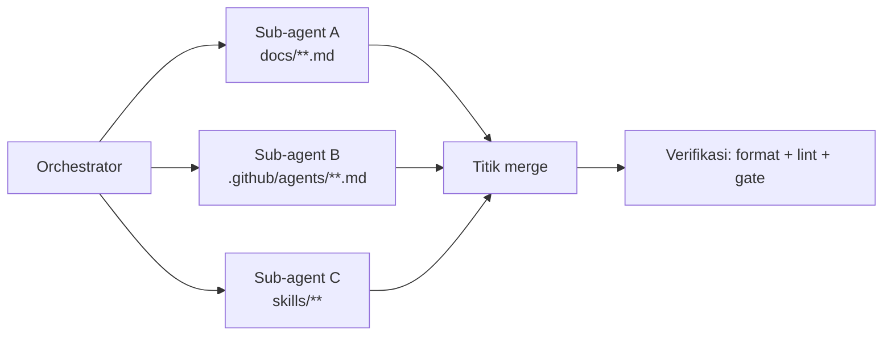

# Agent Delegation — Kontrak per Tahap & Cara Mendelegasikan

> Tujuan dokumen ini: membuat **delegasi ke sub-agent aman dan bisa diparalelkan**. Setiap tahap punya satu kontrak eksplisit — input apa, output ke path mana, siapa yang memiliki file itu, dan gate apa yang bisa memblokirnya. Untuk peta alur runtime, lihat [`AGENT-FLOW.md`](AGENT-FLOW.md).

## Aturan dasar delegasi

1. **Satu tahap = satu sub-agent.** Jangan minta satu sub-agent mengerjakan Model + Generate sekaligus — kontraknya berbeda.
2. **Satu file = satu pemilik.** Dua sub-agent tidak boleh menulis file yang sama secara paralel. Tabel ownership di bawah adalah pagar itu.
3. **Sub-agent tidak boleh mengarang bukti.** Bila evidence/catalog tidak ada, hasilnya adalah `Coverage Gap`, bukan plan `automated`.
4. **Handoff lewat file, bukan lewat percakapan.** Sub-agent menulis artifact ke path kanonik; orchestrator melanjutkan dengan `--resume`.
5. **Selalu verifikasi sebelum resume.** `validate_plan` untuk plan, `validate_generated_tests` untuk spec.

## Kontrak per tahap

### 1. Planner — stage `Model` + `Challenge`

| Aspek                   | Nilai                                                                                                                                                                      |
| ----------------------- | -------------------------------------------------------------------------------------------------------------------------------------------------------------------------- |
| **Input**               | `{ "requirementPath": "requirements/<feature>.md" }`                                                                                                                       |
| **Output (artifact)**   | `specs/<feature>-test-plan.md` (satu file per fitur)                                                                                                                       |
| **Pemilik file**        | Planner — hanya Planner yang menulis `specs/`                                                                                                                              |
| **MCP wajib**           | `compile_requirement`, `compile_test_plan`, `validate_plan`                                                                                                                |
| **MCP pendukung**       | `snapshot_page`, `discover_pages` (bila catalog belum ada), `list_requirement_status`                                                                                      |
| **Gate yang memblokir** | `PLAN_EVIDENCE_MAJORITY_GAP`, `PLAN_EVIDENCE_UNAVAILABLE`, `PLAN_EVIDENCE_MISSING`, `PLAN_LOCATOR_INTENT_MISSING`, `PLAN_SEED_*`, `PLAN_RELATION_*`, `PLAN_DOCTRINE_STALE` |
| **Instruksi lengkap**   | [`.github/agents/planner.agent.md`](../.github/agents/planner.agent.md)                                                                                                    |

**Brief siap-pakai:**

> Baca `requirements/<feature>.md`, kompilasi dengan `compile_requirement`, lalu tulis test plan ke `specs/<feature>-test-plan.md` mengikuti `specs/_TEMPLATE.md`. Setiap skenario `automated` HARUS punya entri catalog evidence (kalau belum ada, jalankan `snapshot_page` dulu); skenario tanpa bukti masuk `## Coverage Gaps`, bukan plan. Verifikasi dengan `validate_plan` sampai status bukan error, lalu laporkan path + jumlah skenario + jumlah coverage gap.

### 2. Generator — stage `Generate`

| Aspek                   | Nilai                                                                                                                                                                                             |
| ----------------------- | ------------------------------------------------------------------------------------------------------------------------------------------------------------------------------------------------- |
| **Input**               | Test plan di `specs/<feature>-test-plan.md`                                                                                                                                                       |
| **Output (artifact)**   | `tests/<feature>.spec.ts` (general) atau `tests/<feature>-<role>.spec.ts` (role-aware)                                                                                                            |
| **Pemilik file**        | Generator — hanya Generator yang menulis `tests/`                                                                                                                                                 |
| **MCP wajib**           | `validate_generated_tests`                                                                                                                                                                        |
| **MCP pendukung**       | `snapshot_page` (live verification), `generate_page_object`                                                                                                                                       |
| **Aturan keras**        | Auth HANYA via `test.use({ storageState: authStatePath('<role>') })` — tidak pernah login di dalam test. Locator ephemeral (`tw-XXXX`) dilarang. Setiap spec harus meng-assert sesuatu (`expect`) |
| **Gate yang memblokir** | `GENERATE_BLOCKED` (plan belum lulus Challenge), `validate_generated_tests` error                                                                                                                 |
| **Instruksi lengkap**   | [`.github/agents/generator.agent.md`](../.github/agents/generator.agent.md)                                                                                                                       |

**Brief siap-pakai:**

> Baca `specs/<feature>-test-plan.md`, tulis spec ke path kanonik `tests/<feature>[-<role>].spec.ts` mengikuti `.github/agents/generator.agent.md`. Pakai `test.use({ storageState: authStatePath('<role>') })`; jangan login di dalam test; jangan pakai locator ephemeral. Skrip `not-implemented` → `test.fixme` (bukan `test.skip`). Verifikasi dengan `validate_generated_tests`, lalu laporkan daftar file + jumlah test.

### 3. Healer — stage `Validate` (feedback re-entry)

| Aspek                 | Nilai                                                                                                                    |
| --------------------- | ------------------------------------------------------------------------------------------------------------------------ |
| **Input**             | Payload kegagalan dari `get_test_failures` (trace/screenshot path)                                                       |
| **Output (artifact)** | Perbaikan spec di tempat **atau** klasifikasi `cannotFix` + `failureSource`                                              |
| **Pemilik file**      | Healer boleh menyunting spec yang sudah ada di `tests/`; **tidak** menulis `specs/`                                      |
| **MCP wajib**         | `get_test_failures`, `record_ai_note`                                                                                    |
| **Batas keras**       | Maksimum **3 re-entry pass per `loopTarget`** → ke-4 diblokir `LOOP_LIMIT_REACHED`                                       |
| **Aturan auth**       | Kegagalan auth (`401/403/session expired`) **tidak boleh di-heal** — klasifikasikan `env`, jalankan `npm run auth:setup` |
| **Instruksi lengkap** | [`.github/agents/healer.agent.md`](../.github/agents/healer.agent.md)                                                    |

**Brief siap-pakai:**

> Ambil kegagalan dengan `get_test_failures`. Untuk tiap kegagalan: tentukan `failureSource` (`app|test|requirement|env|ai_generation|unknown`). Bila cek trace/screenshot menunjukkan halaman login → klasifikasikan `env`, JANGAN tambal locator. Perbaiki hanya yang `test`/`ai_generation`, lalu `record_ai_note` (source `healer`, bahasa Indonesia) untuk setiap perbaikan dan setiap `cannotFix`. Jangan melebihi 3 pass untuk target yang sama.

### 4. Reporter — stage `Validate` → Report(Analyze)

| Aspek                 | Nilai                                                                                                                                                                                                                    |
| --------------------- | ------------------------------------------------------------------------------------------------------------------------------------------------------------------------------------------------------------------------ |
| **Input**             | `runId`, `requirementPath`, `rolesInScope`, hasil healing                                                                                                                                                                |
| **Output (artifact)** | `artifacts/reports/pipeline-report-<runId>.md` + JSON `PipelineReport`                                                                                                                                                   |
| **Pemilik file**      | Reporter — hanya Reporter yang menulis `artifacts/reports/pipeline-report-*`                                                                                                                                             |
| **MCP wajib**         | `trace_requirement`, `get_test_summary`, `get_test_failures`, `record_ai_note` (`source: "reporter"`, minimal satu `scope: "run"`), `archive_report`                                                                     |
| **Gate APPROVE**      | `analysisVerdict: "complete"` + `analysisVerified: true` + ada run insight `source: "reporter"` + tanpa unresolved failure. Kalau tidak → `ANALYSIS_INCOMPLETE` / `ANALYSIS_UNVERIFIABLE` / `ANALYSIS_EVIDENCE_MISMATCH` |
| **Instruksi lengkap** | [`.github/agents/reporting.agent.md`](../.github/agents/reporting.agent.md)                                                                                                                                              |

**Brief siap-pakai:**

> Bangun traceability dengan `trace_requirement`, ambil `get_test_summary` + `get_test_failures`. Wajib panggil `record_ai_note` minimal sekali dengan `scope: "run"` dan `source: "reporter"` (bahasa Indonesia, format kanonik `skills/qa-playwright-kit/references/ai-insight-format.md`), plus insight per skenario bila bukti mendukung — termasuk untuk skenario yang LULUS. Tulis laporan ke `artifacts/reports/pipeline-report-<runId>.md` dan JSON dengan blok `analysis` + `analysisVerdict`/`analysisVerified`. Jangan mengarang insight bila bukti kurang.

## Matriks ownership (pagar paralel)

| Path                                  | Pemilik   | Boleh dibaca siapa | Boleh ditulis siapa                |
| ------------------------------------- | --------- | ------------------ | ---------------------------------- |
| `requirements/**`                     | QA User   | semua              | QA User / `update_requirement`     |
| `specs/**`                            | Planner   | semua              | **Planner saja**                   |
| `tests/**`                            | Generator | semua              | **Generator saja**                 |
| `artifacts/reports/pipeline-report-*` | Reporter  | semua              | **Reporter saja**                  |
| `artifacts/selector-catalog/**`       | Explore   | semua              | `snapshot_page` / `discover_pages` |
| `artifacts/reports/test-notes.json`   | sidecar   | semua              | `record_ai_note` / `set_test_note` |

## Pola delegasi paralel yang aman

Tahap pipeline bersifat **sekuensial** (Model → Challenge → Generate → Validate) — jangan diparalelkan. Yang aman diparalelkan adalah **pekerjaan sampingan dengan file disjoint**:

Aturan paralel:

1. **File harus disjoint** — cek tabel ownership sebelum men-spawn dua sub-agent.
2. **Jangan paralelkan dua sub-agent di satu file** (mis. dua orang menyunting `generator.agent.md`).
3. **Satu verifikasi di akhir** — jalankan gate setelah semua merge, bukan per sub-agent.
4. **Tahap pipeline tidak pernah paralel** — `workflow_run` adalah state machine satu-run-per-workspace.

## Cek cepat sebelum mendelegasikan

- [ ] Sub-agent tahu **path output** persisnya (bukan hanya "tulis plan").
- [ ] Sub-agent tahu **file mana yang bukan miliknya**.
- [ ] Sub-agent tahu **gate apa** yang akan memblokir hasilnya.
- [ ] Sub-agent tahu **perintah verifikasi** (`validate_plan` / `validate_generated_tests`).
- [ ] Bila hasilnya mengubah kontrak, **dokumen ini + `AGENT-FLOW.md` ikut diperbarui**.
