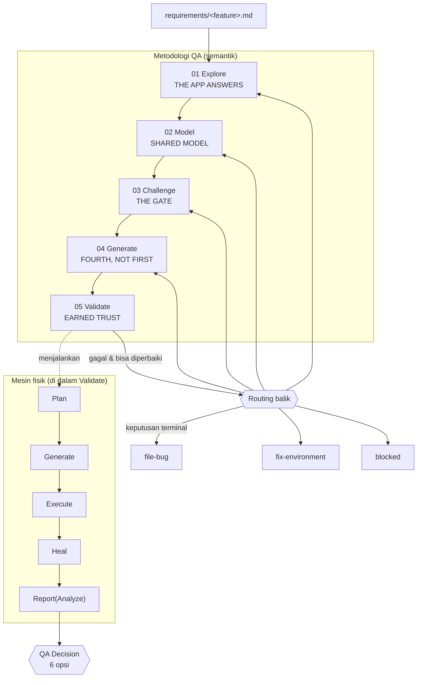

# Agent Flow — Peta Alur Pipeline & Kontrak Handoff

> Dokumen ini menjawab satu pertanyaan: **saat agent AI menjalankan pipeline, ia sedang di mana, apa yang harus ia lakukan, dan bagaimana ia melanjutkan?** Untuk peta file, lihat [`ARCHITECTURE.md`](ARCHITECTURE.md). Untuk cara mendelegasikan satu tahap ke sub-agent, lihat [`AGENT-DELEGATION.md`](AGENT-DELEGATION.md).

## Dua kosakata yang sering tertukar

Framework punya **dua** urutan yang berbeda. Jangan campur:

| Kosakata                     | Isi                                                  | Dipakai untuk                                                  |
| ---------------------------- | ---------------------------------------------------- | -------------------------------------------------------------- |
| **Metodologi QA (semantik)** | `Explore → Model → Challenge → Generate → Validate`  | Cara berpikir QA; di-enforce runtime oleh `WorkflowController` |
| **Mesin eksekusi (fisik)**   | `Plan → Generate → Execute → Heal → Report(Analyze)` | Jalur kompatibilitas internal; dijalankan di dalam Validate    |

`Heal` hanya **label substage** di jalur fisik — **tidak ada stage handler `heal`**. Yang ada: `src/agents/integration/stages/{explore,model,challenge,generate,validate}.ts`.

Saat Validate gagal, hasilnya **dirutekan balik**, bukan "diulang dari awal":



## Titik pause: kapan pipeline berhenti dan menunggu

Pipeline **tidak pernah** berpura-pura selesai. Ada dua pause sah, dan keduanya menghasilkan `workflowStatus: "blocked"` + sebuah **handoff**.

```mermaid
sequenceDiagram
  participant A as Agent AI (Orchestrator)
  participant W as WorkflowController
  participant X as Aktor eksternal (Planner / Generator)

  A->>W: workflow_run(requirementPath)
  W->>W: Explore → Model
  W-->>A: blocked · handoff: planner-required
  Note over A,X: plan belum ada — Agent menulis specs/&lt;feature&gt;-test-plan.md
  A->>W: workflow_run(--resume --run-id &lt;id&gt;)
  W->>W: Model → Challenge → Generate
  W-->>A: blocked · handoff: awaiting-generator
  Note over A,X: spec belum ada — Agent menulis tests/&lt;feature&gt;.spec.ts
  A->>W: workflow_run(--resume --run-id &lt;id&gt;)
  W->>W: Generate → Validate (Execute → Heal → Report/Analyze)
  W-->>A: qa-decision-required
```

| Handoff (`handoffType`) | Muncul di stage   | Aktor harus menulis                     | Path target                        |
| ----------------------- | ----------------- | --------------------------------------- | ---------------------------------- |
| `planner-required`      | Model             | Test plan                               | `specs/<feature>-test-plan.md`     |
| `awaiting-generator`    | Generate/Validate | Spec Playwright                         | `tests/<feature>[-<role>].spec.ts` |
| `adapter-failed`        | Model             | — (bukan handoff yang bisa diisi agent) | —                                  |

## Kontrak handoff (machine-readable)

Sejak batch ini, `WorkflowResponse.result` **di-typed**, bukan `unknown`. Agent otomatis bisa membaca handoff tanpa men-regex prosa:

```ts
interface WorkflowHandoff {
  handoffType: 'planner-required' | 'awaiting-generator' | 'adapter-failed';
  requiredArtifactPath?: string; // file yang harus ditulis sebelum resume
  resumeCommand?: string;        // perintah resume siap copy-paste
  resumeInstruction?: string;    // instruksi manusia (mirror nextRequiredAction)
  reason?: string;
}
```

- `nextRequiredAction` tetap ada sebagai **kalimat manusia** untuk QA.
- `resumeCommand` adalah bentuk **mesin** dari hal yang sama — dipakai delegator otomatis.
- Keduanya dibangun dari satu sumber: `buildManualResumeInstruction()` di `src/agents/integration/stages/resume-instruction.ts`.

> **Dua jalur yang sama-sama first-class:** (1) agent AI menulis plan/spec lalu resume; (2) QA menulis plan/spec manual, verifikasi, lalu resume. Kontraknya identik — hanya aktornya berbeda.

## Status yang bisa dikembalikan

| `workflowStatus`       | Arti                                                       | Aksi berikutnya                                   |
| ---------------------- | ---------------------------------------------------------- | ------------------------------------------------- |
| `blocked`              | Butuh aksi eksternal (handoff) atau gate menolak           | Baca `result.handoff`, penuhi, lalu `--resume`    |
| `needs-review`         | Ada temuan yang harus di-triage (mis. unresolved failures) | Ikuti `nextRequiredAction` → routing balik        |
| `qa-decision-required` | Semua lulus; menunggu keputusan QA                         | `archive_report` dengan salah satu 6 `qaDecision` |
| `failed`               | Stage error (bukan handoff)                                | Perbaiki penyebab, jalankan ulang                 |
| `success`              | Stage tunggal selesai (mode `stage`)                       | Lanjut ke stage berikutnya                        |

## Kode gate yang bisa memblokir

Gate **fail-closed**: bila bukti tidak cukup, plan tidak pernah sampai ke Generate.

| Kode                                                                           | Stage     | Blokir? | Arti                                                            |
| ------------------------------------------------------------------------------ | --------- | ------- | --------------------------------------------------------------- |
| `PLAN_EVIDENCE_MISSING`                                                        | Challenge | ya      | Skenario `automated` tanpa entri catalog evidence               |
| `PLAN_EVIDENCE_MAJORITY_GAP`                                                   | Challenge | **ya**  | Mayoritas skenario automated tanpa bukti (menebak massal)       |
| `PLAN_EVIDENCE_UNAVAILABLE`                                                    | Challenge | **ya**  | Plan mengklaim catalog evidence yang tidak ada di disk          |
| `PLAN_EVIDENCE_EMPTY` / `PLAN_EVIDENCE_UNVERIFIED`                             | Challenge | ya      | Entri evidence kosong / belum diverifikasi                      |
| `PLAN_LOCATOR_INTENT_MISSING`                                                  | Challenge | ya      | Skenario tanpa `Locator Intent`                                 |
| `PLAN_SEED_UNPROVISIONED` / `PLAN_SEED_UNKNOWN` / `PLAN_SEED_NOT_EXECUTABLE`   | Challenge | ya      | Seed dipakai tapi tak terdaftar / tak punya producer            |
| `PLAN_RELATION_UNCONFIRMED` / `PLAN_RELATION_SEED_UNPROVISIONED`               | Challenge | ya      | Relasi masih `assumption` tapi dipakai untuk assertion runnable |
| `PLAN_DATA_OPERATION_UNCOVERED`                                                | Challenge | ya      | Data operation tanpa cakupan skenario                           |
| `PLAN_DOCTRINE_STALE` / `PLAN_STALE_REQUIREMENT` / `PLAN_STALE`                | Challenge | ya      | Plan dibuat dari doctrine/requirement versi lama                |
| `PLAN_EPHEMERAL_REF` / `PLAN_EPHEMERAL_REF_DETECTED`                           | Challenge | ya      | Locator ephemeral (`tw-XXXX`) bocor ke plan                     |
| `PLAN_ROLE_DRIFT` / `PLAN_AUTH_DRIFT` / `PLAN_EXPECTATION_DRIFT`               | Challenge | ya      | Plan menyimpang dari requirement (role/auth/ekspektasi)         |
| `PLAN_AC_UNCOVERED` / `PLAN_UNKNOWN_AC` / `PLAN_SCENARIO_MISSING`              | Challenge | ya      | AC tidak tercover / AC tak dikenal / skenario hilang            |
| `PLAN_NOT_IMPLEMENTED_NO_GAP`                                                  | Challenge | ya      | `not-implemented` tanpa entri di `## Coverage Gaps`             |
| `PLAN_UNREVIEWED_ASSUMPTION` / `PLAN_UNKNOWN_PROVENANCE`                       | Challenge | ya      | Asumsi belum direview / provenance assertion tak diketahui      |
| `PLAN_HYBRID_*`                                                                | Challenge | ya      | Pelanggaran aturan hybrid-ui (seed/tag/cleanup)                 |
| `EXPLORE_REQUIRED`                                                             | Explore   | ya      | Catalog evidence belum ada; jalankan `snapshot_page` dulu       |
| `MODEL_FAILED`                                                                 | Model     | ya      | Adapter model gagal                                             |
| `CHALLENGE_BLOCKED` / `CHALLENGE_FAILED`                                       | Challenge | ya      | Gate menolak / adapter challenge error                          |
| `GENERATE_BLOCKED` / `GENERATE_FAILED`                                         | Generate  | ya      | Gate generate menolak / generator error                         |
| `VALIDATE_BLOCKED` / `VALIDATE_FAILED`                                         | Validate  | ya      | Validate tak bisa jalan / error                                 |
| `LOOP_LIMIT_REACHED`                                                           | Validate  | ya      | Batas 3 re-entry pass per `loopTarget` tercapai                 |
| `ANALYSIS_INCOMPLETE` / `ANALYSIS_UNVERIFIABLE` / `ANALYSIS_EVIDENCE_MISMATCH` | Report    | ya      | `archive_report` menolak `APPROVE` tanpa bukti Analyze          |
| `RESUME_NOT_SEMANTIC` / `RESUME_STALE_REQUIREMENT`                             | Resume    | ya      | Run lama bukan semantic-v1 / requirement berubah sejak pause    |
| `WORKFLOW_PAUSED` / `WORKFLOW_BLOCKED`                                         | Semua     | —       | Info status pause/block (bukan error)                           |

Sumber kode: `src/contracts/diagnostics.ts` (kode `PLAN_*`/`REQ_*`) dan `src/agents/integration/stages/*.ts` (kode `*_BLOCKED`/`*_FAILED`/`*_TRANSITION`).

## Routing balik: siapa memperbaiki apa

Setelah Validate gagal, `feedback-router.ts` memilih **stage terkecil** yang bisa memperbaiki, dari `failureSource`:

| `failureSource` | `loopTarget`      | Artinya                                        |
| --------------- | ----------------- | ---------------------------------------------- |
| `test`          | `generate`        | Spec salah/stale → perbaiki test               |
| `ai_generation` | `generate`        | Generator salah memahami plan                  |
| `requirement`   | `model`           | Requirement ambigu → perbaiki requirement+plan |
| `env`           | `fix-environment` | Auth/seed/env rusak                            |
| `app`           | `file-bug`        | Bug aplikasi → tiket defect                    |
| `unknown`       | `blocked`         | Bukti tak cukup untuk klasifikasi              |

**Batas:** maksimum **3 re-entry pass per `loopTarget`** (bukan per file). Pass ke-4 diblokir dengan `LOOP_LIMIT_REACHED` — tidak ada looping diam-diam.

## Urutan baca untuk agent yang baru masuk

1. `pipeline_status` — satu panggilan: fase sekarang, keamanan resume, hasil run terakhir, role auth siap.
2. `workflow_run({ requirementPath })` — jalankan/melanjutkan pipeline.
3. Bila `blocked` → baca `result.handoff` → penuhi artifact → `--resume`.
4. Bila `qa-decision-required` → laporkan ke QA → `archive_report`.

Detail per tahap (input/output/ownership): [`AGENT-DELEGATION.md`](AGENT-DELEGATION.md).
